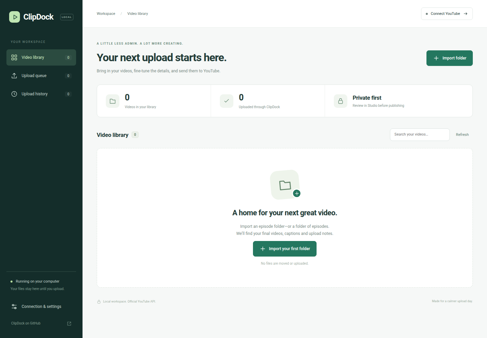

# ClipDock

A local React web app for preparing and privately uploading YouTube videos. Import a folder, review the metadata, connect your channel, and queue your uploads. Runs on your computer in a browser; no hosted ClipDock service or subscription.



**Status:** initial release. Local import, metadata editing, React production build and mocked upload checks are implemented. Google sign-in and a real upload require your own OAuth client and channel authorisation. No real YouTube upload was performed during development. Uploads are always **private**; publish or schedule them in YouTube Studio after review.

## Install from Git

Install **Node.js 24 LTS** and Git first. Then, in a terminal on Linux, Windows (PowerShell) or macOS:

```sh
git clone https://github.com/mmhfarooque/clipdock.git
cd clipdock
npm ci
npm run build
npm start
```

Open **http://127.0.0.1:3210**. Stop with Ctrl+C. Use this exact address, not `localhost`: the server restricts the Host header to protect local access. No Python, Docker, database, ffmpeg or paid API key is needed to run the uploader. This app does not generate or edit video.

To update, stop the app, run `git pull --ff-only`, `npm ci`, `npm run build`, then `npm start`.

Node 22 is also supported by the source; use a current patch version compatible with Vite 8. Automated production builds and core/HTTP tests passed on Ubuntu, Windows and macOS in [GitHub Actions](https://github.com/mmhfarooque/clipdock/actions/runs/40196607185). Browser smoke tests were run with Chromium on Linux. Live Google authentication and uploading remain unverified.

## Import videos

Click **Import folder** and enter an absolute path on the computer running the app. ClipDock scans that directory and its immediate subdirectories. It does not move or modify your episode files.

Preferred video filenames, in order:

1. `final-video-captioned.mp4`
2. `final-video.mp4`
3. `kling-original.mp4`
4. `video.mp4`
5. First other `.mp4`, `.mov` or `.webm` file

Each folder represents one video. For explicit version selection, put the desired file in its own folder or use the preferred filenames. Hidden folders and symlinked files are not imported.

An optional `UPLOAD_LOG.md` supplies metadata:

```md
## Title

A practical household tip

## Description

A clear description of what the video demonstrates.

## Tags

home tips, household, shorts
```

Add `captions.srt` to enable a separate subtitle track. It is **off by default**, because uploading CC alongside burned-in subtitles can cause duplicate visible captions. Actual media processing/Shorts classification is handled by YouTube; ClipDock has no special “make this a Short” switch.

## Connect Google / YouTube once

1. Open [Google Cloud Console](https://console.cloud.google.com/), choose or create your project, and enable **YouTube Data API v3**.
2. Configure Google Auth Platform/OAuth consent. If your OAuth app is in Testing, add the Google account you will use as a test user.
3. Create an OAuth client of type **Web application**.
4. Add **http://127.0.0.1:3210/oauth/callback** as an authorised redirect URI. Use the exact URI shown in ClipDock if you change ports.
5. Download the client JSON. In ClipDock’s **Connection & settings**, import it and select **Sign in with Google**.
6. Choose the Google/Brand account that owns the intended channel. Check the channel name and ID in ClipDock before uploading.

Google handles sign-in in your browser. ClipDock uses OAuth state validation and PKCE. The requested `youtube.force-ssl` scope supports video uploads, channel lookup and caption-track uploads; Google describes it as broad YouTube management access. ClipDock implements no video deletion or automatic public publishing. Disconnect removes local tokens and attempts Google revocation; if revocation fails the UI reports that distinction.

Each installation supplies its own Google OAuth client. The public repository does **not** include a shared OAuth secret. Sharing this app with other people does not exempt an OAuth project from Google verification, YouTube API compliance, quotas, or account restrictions. If Google blocks publishing or a request, follow the provider’s review process; do not bypass restrictions.

## Upload workflow

- Preview the actual file. Edit the title, description, tags, language, category, audience and realistic AI-content disclosure for each video.
- Defaults: Howto & Style, English, not made for kids, realistic synthetic content disclosed. These are starting values, not a substitute for reviewing each video.
- Select videos and click **Review & upload**. Confirm the displayed destination channel and private visibility.
- Uploads run sequentially, with subscriber notifications disabled. Video IDs and returned privacy status are recorded before any optional caption request.
- Open YouTube Studio to inspect processing, captions, content checks and rights, then publish or schedule manually. Some Studio controls are not implemented by this app (for example comments configuration, playlists, thumbnails, paid-promotion settings, monetisation and scheduling).

Uploading technically valid content does not guarantee policy compliance, monetisation, copyright ownership or commercial rights to third-party AI output. Review the source tool’s terms and disclose realistic synthetic content accurately. ClipDock does not check those rights for you.

## Files, credentials and receipts

The server binds only to `127.0.0.1`; there is no remote hosting/multi-user mode. It checks Host, Origin and a per-run request token. Do not expose it through a tunnel, reverse proxy or shared public server.

User configuration is stored outside the checkout:

| OS | Default location |
| --- | --- |
| Linux | `$XDG_CONFIG_HOME/clipdock` or `~/.config/clipdock` |
| macOS | `~/Library/Application Support/ClipDock` |
| Windows | `%APPDATA%\ClipDock` |

`oauth.json` and `tokens.json` contain credentials. They are not encrypted by ClipDock; files are created with owner-only permissions where supported. Protect your OS account and exclude this configuration directory from public sharing. Never commit it. `settings.json` stores private local paths and metadata. `ledger.json` stores content hashes, channel/video IDs, upload outcomes and caption status. The repo’s ignore rules exclude common credential/media files as an extra guard.

Use `PORT` to choose a different port and `CLIPDOCK_STATE_DIR` for a private configuration location **outside the repository**. Defaults are suitable for one local user. Keep the server running until an upload queue finishes.

### Interrupted uploads and duplicate protection

ClipDock hashes each selected file and writes an attempt record before sending it. The same content/channel pair cannot be blindly re-uploaded, including after a timeout or restart. This is intentional: a lost response can mean a video exists on YouTube even though its ID never reached the app.

For a `needs reconciliation` record, check Studio by title/time. There is no automatic retry/reconciliation feature in this initial version. After verifying the remote result, stop the app, back up `ledger.json`, and either fill in the verified video ID/state or remove **only that one attempt entry** if you have established that no upload exists. Do not clear the ledger as a routine retry step. A failed caption upload does not cause another video upload; add the SRT in Studio.

If the app crashes, its `server.lock` file may remain. Confirm no ClipDock process is still running, then remove only `server.lock` from the configuration directory before restarting. Do not remove a live server’s lock.

## Development and tests

```sh
npm run build
npm test
npm start
```

The core tests simulate Google responses; they do not upload or contact Google. Test cases cover metadata parsing, private/AI/audience fields, duplicate protection, interrupted uploads, caption failure after successful upload and symlink escapes. Browser smoke tests use Playwright; see `test/browser-smoke.mjs` for a locally installed Chromium executable.

## Official references

- [YouTube video upload API](https://developers.google.com/youtube/data/reference/rest/v3/videos/insert)
- [Video fields and AI disclosure](https://developers.google.com/youtube/data/reference/rest/v3/videos)
- [Caption-track upload and scope](https://developers.google.com/youtube/data/reference/rest/v3/captions/insert)
- [Google OAuth web-server flow](https://developers.google.com/identity/protocols/oauth2/web-server)

MIT licensed. ClipDock is an independent project and is not affiliated with YouTube or Google.

See [Privacy](PRIVACY.md) and [Terms](TERMS.md) for the local data flow and third-party service terms.
